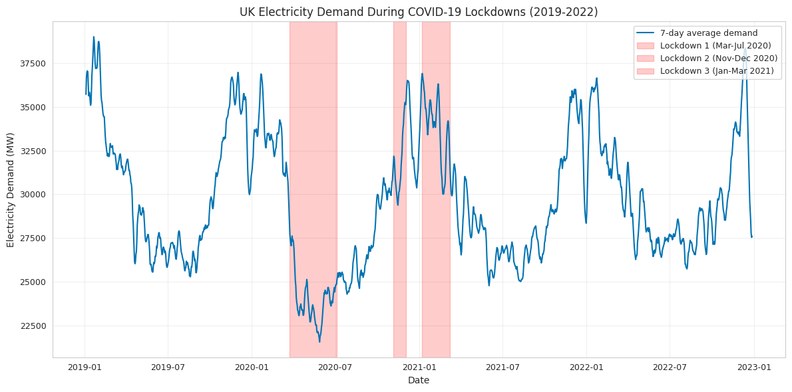
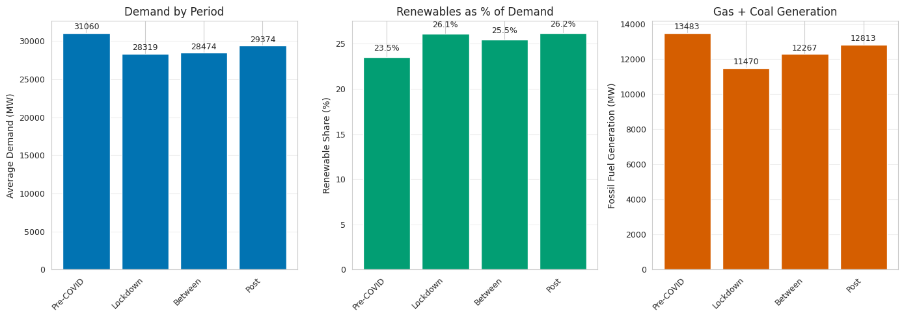
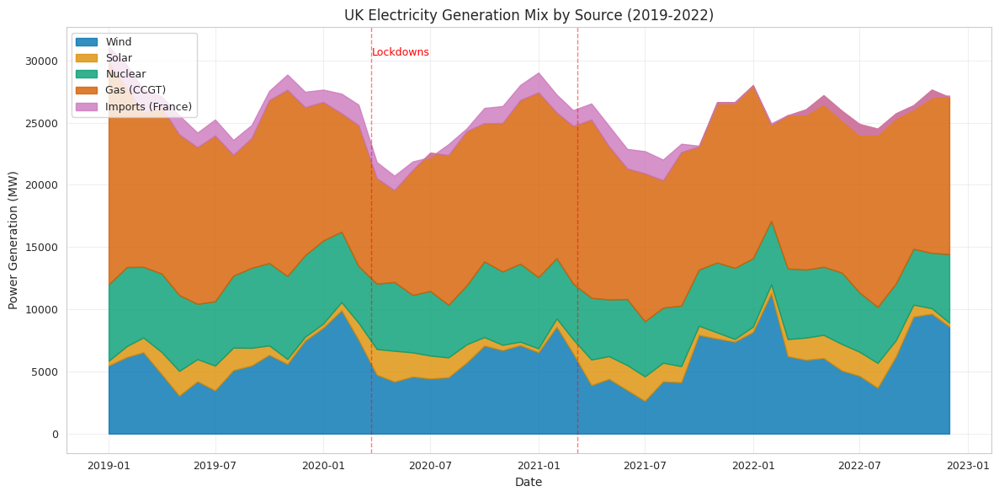

# COVID-19 Lockdowns and UK Electricity Demand

**Did the COVID-19 lockdowns show up in the UK's national electricity demand, and did demand ever bounce back?**

A statistical analysis of **420,000+ five-minute National Grid readings** from 2019 to 2022, in Python. Project for *Informatics 2: Foundations of Data Science*, University of Edinburgh (2025–26).



## Key findings

- **Demand fell 8.82% during lockdowns,** from 31,060 MW before COVID to 28,319 MW during lockdowns, a drop of 2,741 MW.
- **The drop is statistically significant.** A two-sample t-test gave t = 29.57, p < 0.001.
- **The first lockdown hit hardest.** Demand crashed to around 22,000 MW in April–May 2020. The second and third lockdowns had much smaller effects as the economy adapted.
- **Demand never fully recovered.** By the end of 2022 it was still around 27,000–29,000 MW, below 2019 levels, which points to lasting changes such as hybrid working.
- **The fuel mix barely changed.** Renewables supplied a steady 23–26% throughout. The grid scaled down overall rather than switching sources.



| Period | Avg demand (MW) | Renewable share | Gas + coal (MW) |
|---|---|---|---|
| Pre-COVID (2019 – Mar 2020) | 31,060 | 23.5% | 13,483 |
| Lockdowns | **28,319** | 26.1% | 11,470 |
| Between lockdowns | 28,474 | 25.5% | 12,267 |
| Post-lockdown (2021–22) | 29,374 | 26.2% | 12,813 |

## Method

1. **Cleaning.** Parsed the timestamps and removed 68 sensor-error readings below 15,000 MW, leaving 420,421 valid observations.
2. **Periods.** Each reading was labelled pre-COVID, lockdown, between lockdowns or post-lockdown, using the official gov.uk lockdown dates.
3. **Derived variables.** Total renewables (wind + solar), total fossil fuels (gas + coal) and renewable share of demand.
4. **Smoothing.** Readings were averaged to daily values, then a 7-day rolling average was taken, to see the trend through the five-minute noise.
5. **Testing.** A two-sample t-test compared pre-COVID and lockdown demand, using 10,000 sampled readings from each.



## How this compares to other studies

| Study | Reduction found | Why it differs |
|---|---|---|
| Kirli et al. (2021) | 25% | First week of lockdown only |
| Mehlig et al. (2021) | 15.6% | First lockdown, weather-corrected |
| Anderson & James (2021) | ~9% (evening) | Time-of-day breakdown |
| **This project** | **8.8%** | Average across all three lockdowns |

## Limitations and next steps

- **No weather correction.** Lockdowns happened in different seasons, and temperature drives demand. Correcting with heating and cooling degree-days would isolate the lockdown effect.
- **National data only.** Smart-meter data broken down by household and business would show whether homes made up for the drop from offices.
- **Simple lockdown labels.** Each reading is either "lockdown" or not, which ignores gradual easing and regional rules.

## Run it

```bash
pip install -r requirements.txt
python analysis.py data/gridwatch.csv
```

## Tech

Python · pandas · NumPy · SciPy · matplotlib · seaborn · hypothesis testing · time-series smoothing

*Data: gridwatch.templar.co.uk, from National Grid's Balancing Mechanism Reporting Service (BMRS).*
